# Práctica 1.4 — HTTPS con certificado autofirmado en Apache

Despliegue de Apache con HTTPS en una instancia EC2 de AWS, automatizado con scripts.

## 1. Pasos realizados

1. Instancia EC2 con Ubuntu Server LTS, tipo t3.micro.
2. Security Group con entrada TCP 22 (SSH), 80 (HTTP) y 443 (HTTPS).
3. Par de claves creado desde el asistente de lanzamiento de EC2 (Key pair → Create new key pair), con descarga del archivo `.pem` para conectarme por SSH.
4. IP elástica asociada a la instancia.
5. Repositorio clonado en la instancia por SSH, con una clave ed25519 generada en la instancia y registrada en GitHub.
6. Ejecución de `install_apache.sh` y después `setup_selfsigned_certificate.sh`.
7. Entrada en `/etc/hosts` del equipo cliente: `<IP_ELASTICA> practica-https.test`.
8. Pruebas de verificación (sección 3).

## 2. Explicación de los scripts

### install_apache.sh
- Comprueba con `dpkg -s apache2` si Apache está instalado; si lo está, termina.
- Instala con `apt-get install -y` y `DEBIAN_FRONTEND=noninteractive` (sin intervención).
- Habilita y arranca el servicio con `systemctl enable --now apache2`.

### setup_selfsigned_certificate.sh
- Comprueba que Apache está instalado; si no, se detiene.
- Carga todas las variables desde `scripts/.env`.
- Genera clave y certificado con `openssl req -x509`, incluyendo `subjectAltName` con dominio e IP elástica.
- Copia las plantillas de `conf/` a `/etc/apache2/sites-available/` y sustituye los marcadores con `sed`.
- Habilita `ssl`, `rewrite` y el sitio HTTPS.
- Ejecuta `apache2ctl configtest` y, si falla, no reinicia Apache.

### conf/ y .env.example
- `000-default.conf`: virtual host :80 que redirige a HTTPS (301).
- `practica-https-ssl.conf`: virtual host :443 con el certificado.
- `.env.example`: variables con valores de ejemplo. El `.env` real está en `.gitignore`.

## 3. Verificación y evidencias

| Nº | Comprobación | Evidencia |
|----|--------------|-----------|
| 1 | Instalación de Apache | 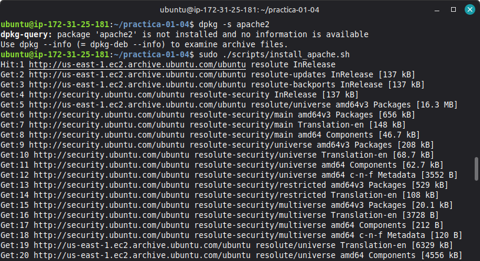 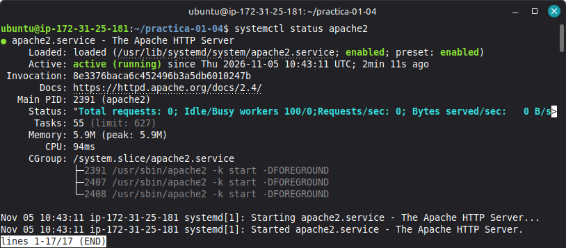 |
| 2 | Reejecución del script | 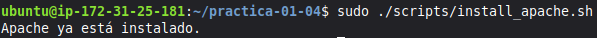 |
| 3 | Certificado (sujeto, validez, SAN) | 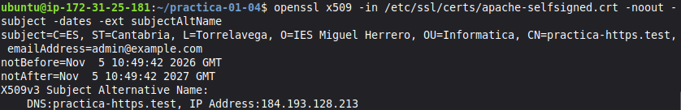 |
| 4 | Sintaxis de Apache |  |
| 5 | Puertos a la escucha | 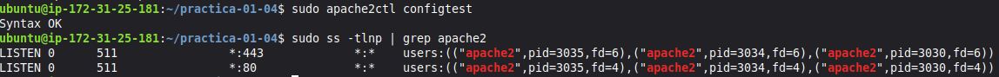 |
| 6 | Redirección HTTP → HTTPS | 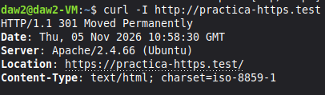 |
| 7 | Respuesta HTTPS | 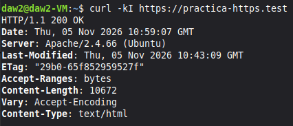 |
| 8 | Negociación TLS | 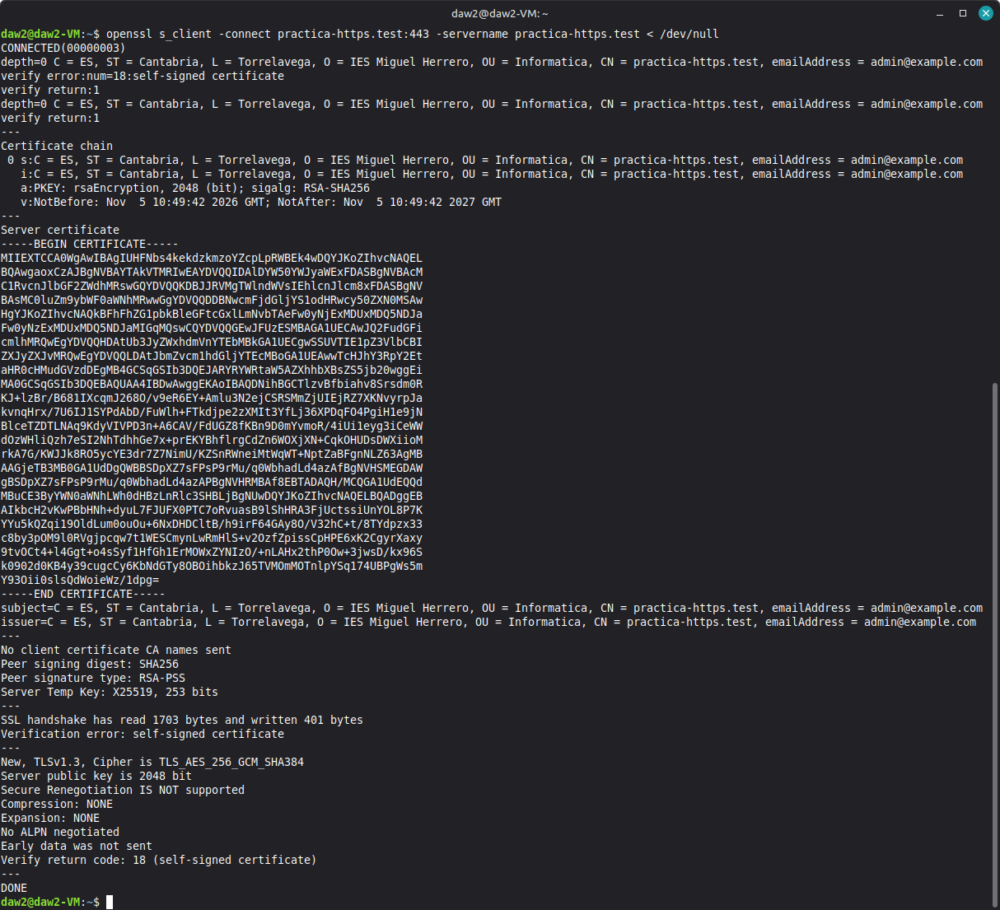 |
| 9 | Navegador (aviso, web y certificado) | 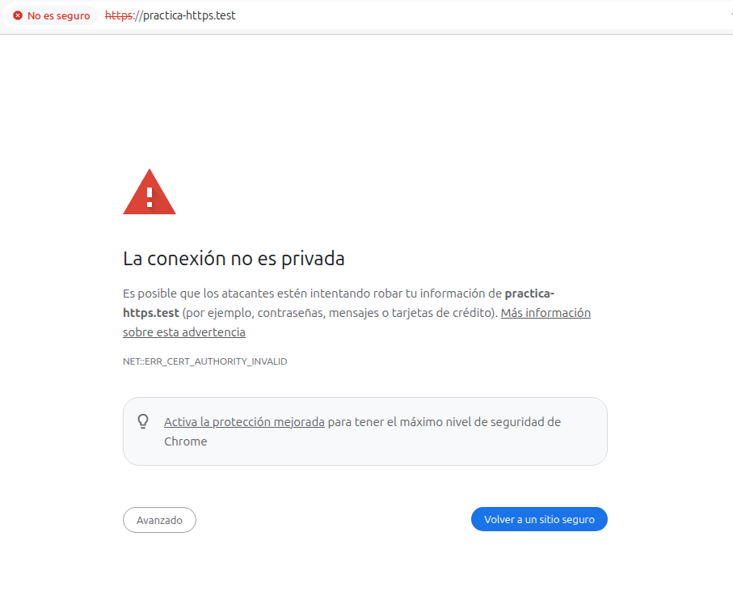 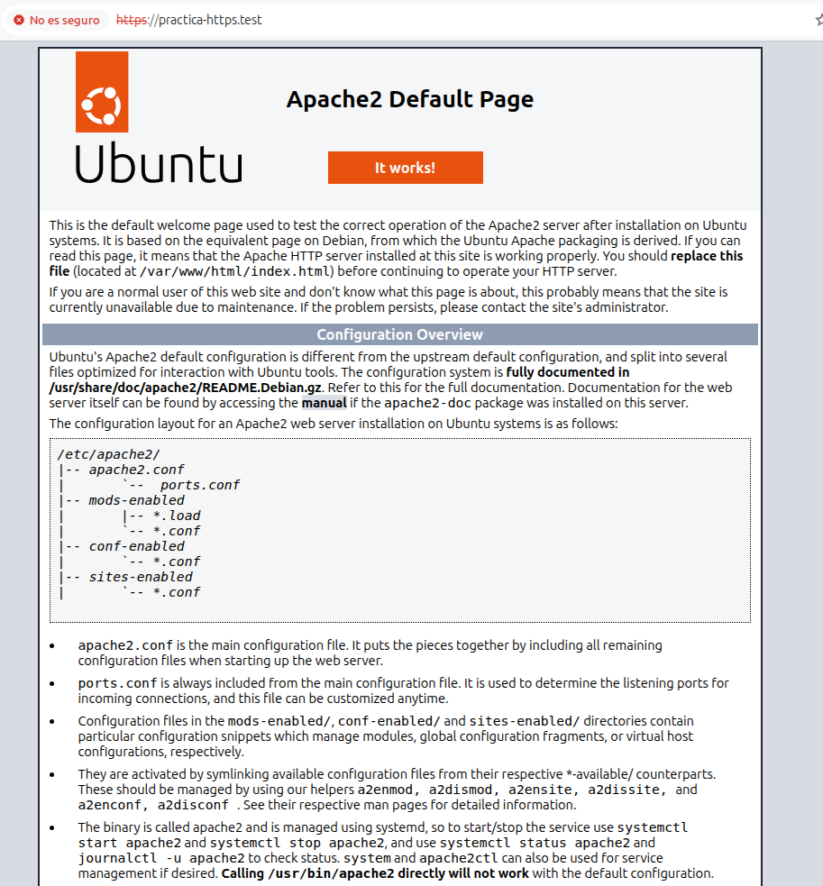 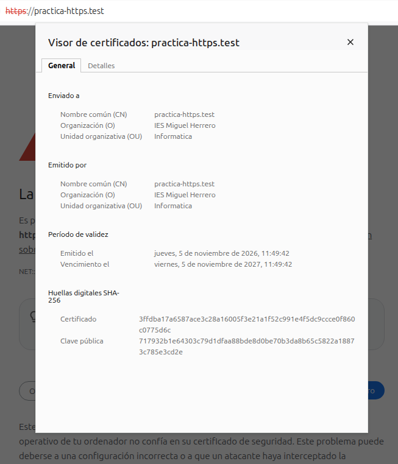 |

## 4. Comprobaciones adicionales

### Acceso por IP elástica (tarea 9)
Se accede también por IP, además del dominio. El certificado incluye la IP
en el SAN, por lo que `https://IP` presenta un certificado válido para esa
dirección (aun así el navegador avisa, porque no lo firma una CA).

- `curl -I http://IP_ELASTICA` → redirección 301 a HTTPS.
- `curl -kI https://IP_ELASTICA` → 200 OK.

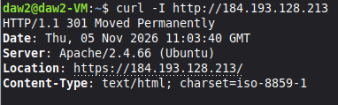 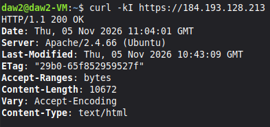

## 5. Seguridad
- La clave privada vive en `/etc/ssl/private/` con permisos 600 y no se sube al repo.
- `.env` y `*.key` están en `.gitignore`.
